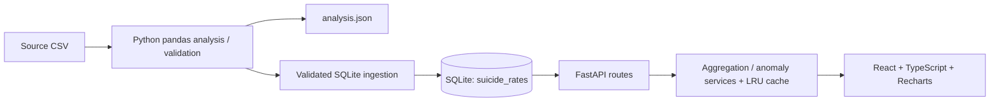

# Global Suicide Rates: Historical Analytics Dashboard

A descriptive dashboard for the supplied SDG-3 age-adjusted suicide-rate dataset (1950–2005). The data pipeline validates the CSV, produces a pandas analysis report, and loads SQLite for a FastAPI JSON API. The React/TypeScript frontend uses the API for all displayed rates and comparisons.

## Data quality report and EDA

| Check | Result | Handling |
|---|---:|---|
| Source rows / columns | 2,843 / 4 | All observations retained |
| Null cells | 0 | No imputation needed |
| Duplicate entity/year keys | 0 | Entity/year key enforced in SQLite |
| Year coverage | 1950–2005, 56 distinct years | Out-of-range years fail validation |
| Entities / source codes | 196 / 196 | 190 codes validate against ISO alpha-3; six former-state entities use known publisher-specific `OWID_*` IDs and remain in historical views |
| Non-country aggregates | None detected | No aggregate rows identified; former polities are not aggregates |
| Non-positive rates | 0 | Rates must be finite and non-negative |
| IQR rate outliers | 82 | Tukey upper fence 30.9199; retained, including the maximum 44.3521 (Lithuania, 1996) |
| Missing entity-years between each entity's first and last report | 331 | Not interpolated; surfaced as coverage gaps |

| Observation-level rate summary | Value per 100,000 |
|---|---:|
| Mean | 11.9502 |
| Median | 10.6410 |
| Sample standard deviation | 7.7495 |
| Minimum | 0.0384 |
| Q1 | 6.2216 |
| Q3 | 16.1009 |
| Maximum | 44.3521 |

| Rate distribution | Observations |
|---|---:|
| 0–5 | 507 |
| 5–10 | 820 |
| 10–15 | 714 |
| 15–20 | 393 |
| 20–25 | 218 |
| 25–30 | 96 |
| 30–35 | 51 |
| 35–40 | 37 |
| 40+ | 7 |

There are 2,843 observations across 196 entities (about 14.5 records per entity on average). Coverage is highly uneven: 121 entities have only 3 observations, while 8 have all 56 years. There are 331 missing entity-years between entities' first and last observations; more years are absent outside each entity's reported span. Annual record counts range from 10 in 1950 to 191 in 2004 and 2005. A notable coverage discontinuity is 62 reporting entities in 2001, 190 in 2002, 55 in 2003, and 191 in 2004.

The reproducible report at `data/analysis_report.json` contains exact rows per year, entity coverage, distribution summaries, leaderboard, panel sensitivity, anomaly results, and insight caveats. Run `python -m backend.analysis` to regenerate it.

## Methodology and findings

- **Averages:** annual trend points are unweighted means of the entities with a reported value in that year. The all-years KPI is the mean of all country-year records (11.9502), matching the supplied ~11.95 fact. This maximizes use of available observations and makes the changing denominator visible in the trend export. It is not a fixed-population global estimate.
- **Panel sensitivity:** the eight entities with complete annual observations over 1950–2005 (Australia, Canada, Ireland, Japan, Netherlands, New Zealand, United Kingdom, United States) have a mean of annual panel averages of 10.6664 and a peak in 1998 (12.2129), rather than 1982. This limited panel is selected and not representative; the main dashboard uses all reported entities and shows annual reporting counts.
- **Country ranking:** at least 10 observations are required; six publisher-coded former states are excluded from the “current country” ranking but remain in source-derived trend, comparison, and coverage data. Eligible top 10 are Lithuania (35.13; 23 years), Russia (30.77; 24), Hungary (29.85; 51), Estonia (27.67; 23), Latvia (27.52; 26), Kazakhstan (25.86; 23), Belarus (25.55; 22), Slovenia (25.36; 21), Finland (22.15; 54), and Ukraine (21.60; 23). Without a minimum, the simple mean top three are Lithuania (35.13; 23), Guyana (30.85; 3), and Russia (30.77; 24), reproducing the provided names but exposing Guyana’s sparse coverage.
- **Anomalies:** compute changes only when the same entity has observations in consecutive calendar years. Pooled signed changes have mean −0.0211 and sample SD 1.2696. `|z| > 2` flags 122 changes; Tukey 1.5×IQR fences (−1.9614, 1.8730) flag 235; 122 overlap. Z-scores scale distance from the pooled mean, while IQR fences focus on the distribution's tails. Neither flags errors or explains causes.
- **Known facts:** the overall observation mean is 11.9502; the simple annual mean peaks in 1982 at 14.7637 (52 reporting entities). Unfiltered country means reproduce Lithuania 35.1272, Guyana 30.8475, and Russia 30.7656. The displayed ranking uses the stated 10-year rule, so Guyana is excluded.

### Plain-language insights (with caveats)

1. The record-weighted mean is 11.95 and the median is 10.64. **Caveat:** the number of reporting entities varies by year.
2. The simple annual mean peaks in 1982 at 14.76 among 52 reporters. **Caveat:** a fixed panel of eight has a different peak (1998, 12.21).
3. Lithuania leads the 10+ year leaderboard at 35.13 (23 observations). **Caveat:** rankings depend on minimum coverage; Guyana's three observations place it second without that rule.
4. Reporters increase from 10 in 1950 to 191 in 2004/2005. **Caveat:** coverage changes can shift raw averages.
5. Only eight entities have a complete annual series. **Caveat:** these entities are a selected, nonrepresentative panel.
6. Z-score and IQR anomaly methods flag 122 and 235 annual changes, respectively. **Caveat:** these are descriptive screening flags, not proof of errors or causes.
7. Eighty-two rates exceed Tukey's IQR fences; the maximum is Lithuania's 44.35 in 1996. **Caveat:** statistical outliers are retained absent evidence of invalidity.

## Architecture



### Folder structure

```text
backend/
  analysis.py        # pandas quality audit, EDA, trends, coverage, anomalies, insights
  ingest.py          # validated SQLite loader
  db.py              # SQLite connection
  main.py            # versioned FastAPI routes, OpenAPI, CORS, error responses
  services.py        # server-side aggregations and cached services
  tests/test_services.py
data/
  SDG-3___suicide-rates-by-country.csv
  analysis_report.json
  suicide_rates.sqlite
frontend/
  src/App.tsx        # responsive dashboard
  src/api.ts         # typed API client
  src/styles.css     # tokens, responsive layout, light/dark theme
  Dockerfile
docker-compose.yml
```

### Database

`suicide_rates(entity TEXT, code TEXT, year INTEGER, rate REAL)` uses `(entity, year)` as its primary key and has indexes on `entity` and `year`. SQLite constraints enforce the source year range and nonnegative rates.

### API

OpenAPI UI: `http://localhost:8000/docs`

For Vercel, `vercel.json` routes `/api/*` and the FastAPI documentation paths to the backend service, and all other paths to the Vite frontend. It includes the generated data files in the FastAPI function bundle. The FastAPI build command regenerates `data/analysis_report.json` and the SQLite database from the tracked CSV before deployment. The Vercel warning about FastAPI static-file collection is not used to serve the dashboard: the frontend is built and served by its separate Vite service.

| Endpoint | Output |
|---|---|
| `GET /api/v1/kpis?from=1950&to=2005` | Global record mean, annual peak year/value, highest eligible country, entity count |
| `GET /api/v1/trend/global?from=&to=` | Annual mean and reporting count |
| `GET /api/v1/countries/top?n=10&from=&to=` | Coverage-qualified country means |
| `GET /api/v1/countries` | Entity/code selector |
| `GET /api/v1/compare?entity=Lithuania&from=&to=` | Country and same-year global means |
| `GET /api/v1/anomalies?entity=Lithuania&method=zscore&threshold=2&from=&to=` | Consecutive-year anomaly changes (`zscore` or `iqr`) |
| `GET /api/v1/coverage?from=&to=&limit=250&offset=0` | Coverage years, first/last years, and internal gaps |
| `GET /api/v1/insights` | Analysis findings and caveats |

Expensive parameterized aggregations are cached in-process; coverage and anomaly/country list routes support pagination as applicable. Invalid inputs return FastAPI JSON validation errors; an unknown entity returns a consistent 404 error. CORS origins are configurable with `CORS_ORIGINS`.

## Run locally

Requires Python 3.11+ and Node.js 20+.

```powershell
# From the project root
python -m venv .venv
.\.venv\Scripts\Activate.ps1
pip install -r requirements.txt
python -m backend.analysis
python -m backend.ingest
python -m unittest discover -s backend\tests -v
uvicorn backend.main:app --reload
```

In another terminal:

```powershell
cd frontend
npm install
npm run dev
```

Open `http://localhost:5173`. The Vite development server proxies `/api` to `http://localhost:8000`. To run the production containers instead, use `docker compose up --build` and open `http://localhost:8080`.

## Wireframe and design system

1. Top bar: data identity, historical date range, theme toggle.
2. Intro: dashboard title and global year range inputs/sliders.
3. Four KPIs: observed-record global mean, peak year, highest eligible country, entities represented.
4. Full-width annual trend hero; reporting count available in exact CSV export and tooltip.
5. Top-10 horizontal bar chart with a zero-based value axis.
6. Country/global dual-line comparison with a searchable, keyboard-operable country datalist.
7. Selected-country anomaly table; year range drives anomaly and chart data.
8. Reporting coverage chart, followed by key findings and methodology caveats.
9. About-data and safe-messaging footer with international crisis-resource link.

Color tokens use calm teal (`#287c68`) and blue (`#647aab`), neutral surfaces, visible focus rings, and contrast-aware text. Typography uses local system sans-serif fonts without third-party font requests. All charts include exact CSV and PNG downloads, labelled controls, text summaries, and responsive layouts.

## Assumptions and future improvements

- “Global average” is the arithmetic mean of reported country-year records, not a population-weighted rate; trend points are the arithmetic mean among that year's reporters.
- Former-state records are valid historical source entities, not current countries; they remain available outside the current-country top ranking.
- No attempt is made to impute missing years, correct outliers, infer causes, or predict future rates.
- Add newer comparable data beyond 2005, source metadata/versioning, regional and gender breakdowns, population weights if defensible, and a documented sensitivity analysis for alternative panels and coverage thresholds.
